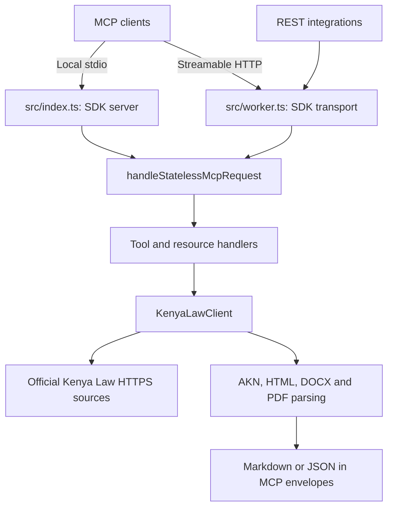

# Architecture

Kenya Law MCP is an independent, read-only server. It requires no application backend, database, account or model provider. Generic retrieval belongs in this upstream project; application-specific reasoning and workflows belong in its consumers.

## Communication

[`createMcpServer`](../src/index.ts) registers eight tools, resources and research prompts with the installed MCP SDK. `handleStatelessMcpRequest` shares dispatch across transports, validates JSON-RPC envelopes and advertised argument types, and keeps existing handler aliases. Tool names and parameter schemas are unchanged. Malformed advertised numbers, months and array items fail before retrieval.

[`worker.ts`](../src/worker.ts) uses `WebStandardStreamableHTTPServerTransport` at `/mcp` and shared dispatch at `/api/v1/<tool>`. Notifications return 202; GET event streams are unavailable and return 405. The SDK negotiates versions it supports, rather than claiming every newer extension. [`generate-openapi.ts`](../scripts/generate-openapi.ts) generates REST schemas from `TOOLS`.

Results use `content` and optionally `isError`. Some text blocks contain JSON; documents contain Markdown. HTTP 200 is not tool success. Resource failures are protocol errors. Public research prompts guide the client; this server does not call an LLM or generate interpretations.

## Retrieval

[`KenyaLawClient`](../src/client/kenyaLawClient.ts) uses official directories, searches and feeds. Directory pagination reaches page 2 only. Discovery records are separate from readable documents. Citation verification checks identifying metadata after retrieval; `check_citator` returns `not_checked` for subsequent treatment.

`normalizeDocumentUrl` permits HTTPS on `kenyalaw.org` and `new.kenyalaw.org`, with AKN/judgment-directory paths and no credentials or custom ports. `fetchDocument` validates every redirect and stops after five redirects. Viewer sources resolve relative to the canonical response URL and pass the same validation. Downloads and decompressed DOCX XML stop at 20 MiB.

[`parseAknXml`](../src/akn/parser.ts) handles XML and recognized HTML markup. The client extracts DOCX body XML with supported ZIP methods. [`extractPdfDocument`](../src/client/pdf.ts) uses the existing `unpdf` PDF.js engine, accepts bytes, reads at most 500 pages sequentially and destroys its loading task. It does not render PDFs, follow PDF links or execute PDF actions. Blank pages retain their positions and an OCR notice; entirely unreadable PDFs fail.

Bare PDFs can be readable with `docType: "unknown"` and `pageCount`; readability does not certify identity. Viewer sources can retain available official-page metadata. No title, citation or legal status is inferred solely from a PDF text layer. Provision extraction is heuristic and fails when the requested boundary cannot be located.

## Privacy and storage

Document/query maps each retain at most 100 entries for one hour. Writes drop expired entries and evict the oldest insertion at capacity; reads do not promote entries. This is not an LRU policy. Limits count entries rather than bytes. There is no disk storage or durable cache.

Local stdio sends queries/URLs from the user's machine to Kenya Law; remote connections also send them through the host. Tools do not read workspace files, upload private documents or use model keys. Source text is untrusted evidence, not permission to perform privileged actions. Consumers must enforce their own execution and privacy boundaries.

## Deployment and unresolved limits

The Worker has no authentication or application rate limiter. It rejects opaque, malformed and non-HTTPS browser origins but accepts other HTTPS origins. Per-request timeouts, bulk caps and parser limits are not global abuse controls. Operators must assess capacity, hosting privacy and upstream conditions before deployment. Worker observability is enabled; hosting logs/retention are an operator responsibility. Application code does not log queries or retrieved text.

Document redirect validation does not imply the same per-redirect path checks for all search/feed requests. Search response sizes, aggregate request concurrency and cache bytes are not globally bounded. HTML/DOCX parsing, PDF text order and section boundaries need source inspection. Cause lists do not verify dates; Gazette access uses a legacy interface. No OCR, comprehensive citator, amendment graph or validity service is implemented.

Synthetic tests exercise parsers, handlers and SDK transports. They do not establish live access, deployment success or application UI compatibility. Run separate live and intended-client checks before release.
